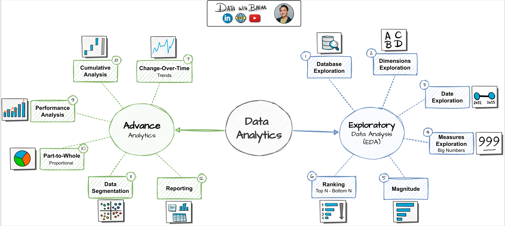

# Data Warehouse and Analytics Project w/ PostgreSQL  
Welcome to my Data Warehouse and Analytics Project repository! This project demonstrates a comprehensive data warehousing and analytics solution, from building a data warehouse to generating actionable insights.  

## Project Overview

This project involves:  

1. **Data Architecture**: Designing a Modern Data Warehouse Using Medallion Architecture (**Bronze**, **Silver**, and **Gold** layers).
2. **ETL Pipelines**: Extracting, transforming, and loading data from source systems into the warehouse.
3. **Data Modeling**: Developing fact and dimension tables optimized for analytical queries.
4. **Analytics & Reporting**: Creating SQL Views to support reporting and future dashboard development.

## Data Architecture  

  

## Integration Model  

  

## Data Flow Diagram  

  

## Data Model (Star Schema)  

  

## Building Layers  

**Initialize the database first:** [Database Initialization](04_scripts/init_database.sql)

1. **Bronze Layer**: Stores raw data as-is from the source systems. Data is ingested from CSV Files into ***Postgres*** Database.  
  - [DDL Bronze Layer](04_scripts/1_bronze/ddl_bronze.sql)
  - [Procedure Load Bronze](04_scripts/1_bronze/procedure_load_bronze.sql) (Update the file paths in the procedure to match the location where you stored the CSV files on your own computer.)
2. **Silver Layer**: Includes data cleaning processes to prepare data for analysis.
  - [DDL Silver Layer](04_scripts/2_silver/ddl_silver.sql)
  - [Procedure Load Silver](04_scripts/2_silver/procedure_load_silver.sql)
3. **Gold Layer**: Business-ready data, modeled into a star schema, required for reporting and analytics.
  - [DDL Gold Layer](04_scripts/3_gold/ddl_gold.sql)

**Gold Layer Data Catalog:** [Data Catalog](02_docs/data_catalog.md)  

---
# Data Analysis  
  

## EDA  
We try to understand all the aspects of our datasets.  

1. [Database Exploration](./06_analysis/1_EDA/01_Database_Exploration.sql): Inspect the tables/views and columns available in the Gold schema. 

2. [Dimensions Exploration](./06_analysis/1_EDA/02_Dimensions_Exploration.sql): Identify distinct values in dimension attributes and understand possible groupings and the granularity of the dimensions.  

3. [Date Exploration](./06_analysis/1_EDA/03_Date_Exploration.sql): Identify date boundaries and understand the timespan of sales data and the birth-date range of customers.  

4. [Measures Exploration](./06_analysis/1_EDA/04_Measures_Exploration.sql): Calculate key business metrics to establish a high-level overview of the business.  

5. [Magnitude and Ranking Analysis](./06_analysis/1_EDA/05_Magnitude_Ranking_Analysis.sql): Compare business measures across products, categories, subcategories, and customer segments. Rank the results from highest to lowest.