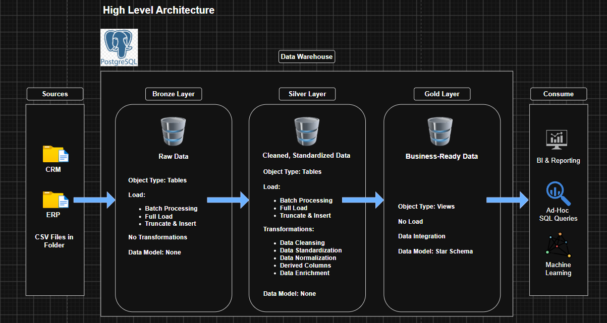
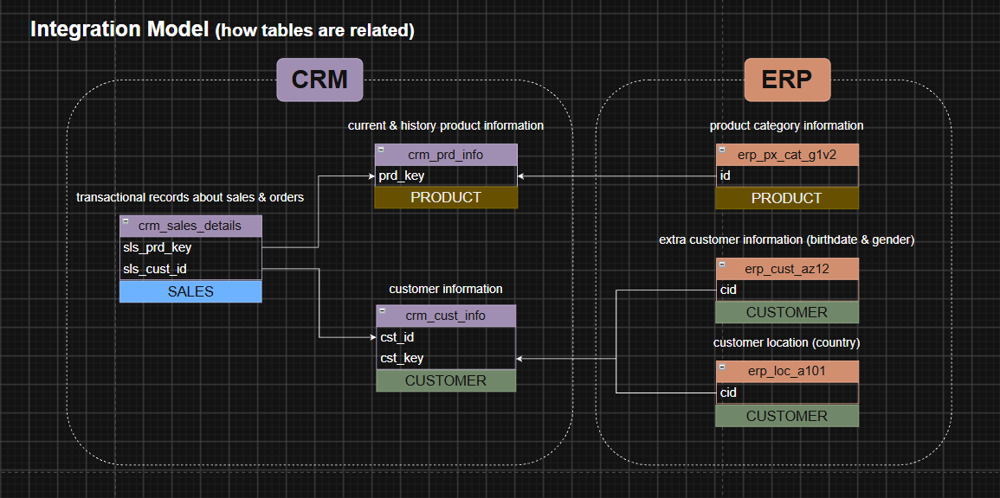
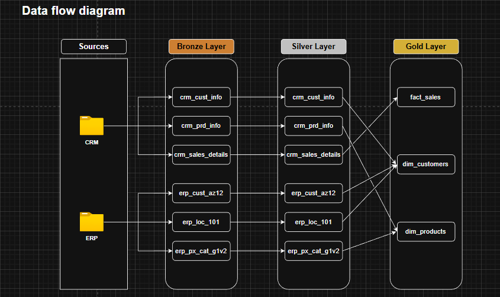
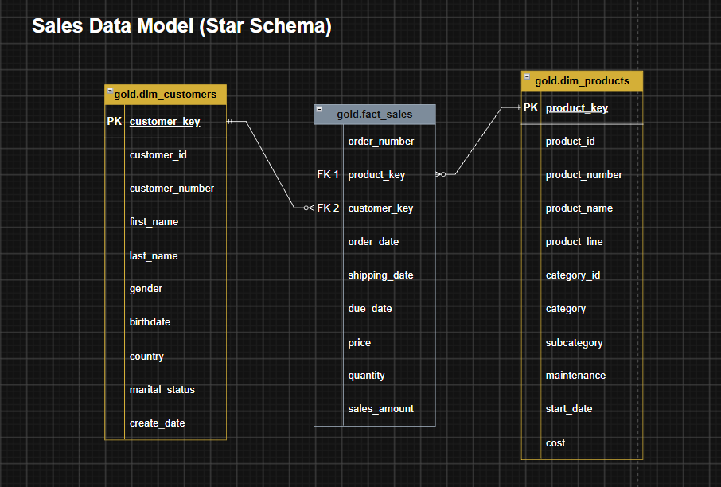

# Data Warehouse and Analytics Project w/ PostgreSQL  
Welcome to my Data Warehouse and Analytics Project repository! This project demonstrates a comprehensive data warehousing and analytics solution, from building a data warehouse to generating actionable insights.  

## Project Overview

This project involves:  

1. **Data Architecture**: Designing a Modern Data Warehouse Using Medallion Architecture (**Bronze**, **Silver**, and **Gold** layers).
2. **ETL Pipelines**: Extracting, transforming, and loading data from source systems into the warehouse.
3. **Data Modeling**: Developing fact and dimension tables optimized for analytical queries.
4. **Analytics & Reporting**: Creating SQL Views to support reporting and future dashboard development.

## Data Architecture  

  

## Integration Model  

  

## Data Flow Diagram  

  

## Data Model (Star Schema)  

  

## Building Layers  

[Database Initialization](04_scripts/init_database.sql)

1. **Bronze Layer**: Stores raw data as-is from the source systems. Data is ingested from CSV Files into **Postgres** Database.  
  - [DDL Bronze Layer](04_scripts/1_bronze/ddl_bronze.sql)
  - [Procedure Load Bronze](04_scripts/1_bronze/procedure_load_bronze.sql)
2. **Silver Layer**: Includes data cleaning, standardization, and normalization processes to prepare data for analysis.
  - [DDL Silver Layer](04_scripts/2_silver/ddl_silver.sql)
  - [Procedure Load Silver](04_scripts/2_silver/procedure_load_silver.sql)
3. **Gold Layer**: Business-ready data, modeled into a star schema, required for reporting and analytics.
  - [DDL Gold Layer](04_scripts/3_gold/ddl_gold.sql)
